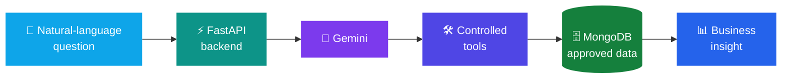
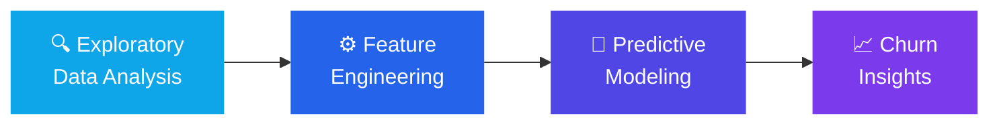
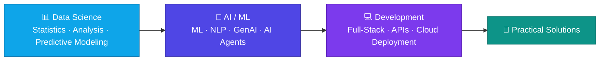
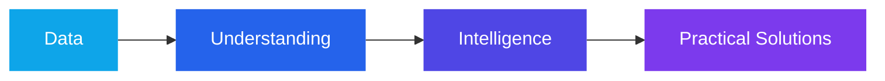

<!-- ═══════════════════════ HERO ═══════════════════════ -->
<div align="center">

<!-- Animated hero (file: assets/hero.svg) -->
<a href="https://paras-kosambe.vercel.app/">
  
</a>

<br/>

<p>


</p>

<br/>

<!-- Live one-liner -->


<br/><br/>

<!-- ═══════════════════════ NAVIGATION ═══════════════════════ -->
<p>
<a href="https://paras-kosambe.vercel.app/"></a>
<a href="#about"></a>
<a href="#projects"></a>
<a href="#stack"></a>
<a href="#analytics"></a>
<a href="#roadmap"></a>
<a href="#contact"></a>
</p>

<br/>

<!-- ═══════════════════════ SOCIAL BUTTONS ═══════════════════════ -->
<p>
<a href="mailto:paraskosambe@gmail.com" title="Email me"></a>
<a href="https://www.linkedin.com/in/paras-kosambe" title="LinkedIn"></a>
<a href="https://www.instagram.com/paras.arts.3313/" title="Instagram"></a>
<a href="https://paras-kosambe.vercel.app/" title="Live portfolio"></a>
<a href="https://github.com/paraskosambe-web?tab=repositories" title="Repositories"></a>
</p>

<br/>

<!-- Animated skills marquee (file: assets/skills-marquee.svg) -->


<br/><br/>

<!-- ═══════════════════════ LIVE PORTFOLIO CTA ═══════════════════════ -->
<a href="https://paras-kosambe.vercel.app/" title="Open my live portfolio">
  
</a>

<br/><br/>

<!-- Animated quick links (files: assets/btn-*.svg) -->
<a href="https://paras-kosambe.vercel.app/" title="Live portfolio website"></a>
<a href="https://paras-kosambe.vercel.app/projects" title="All projects"></a>
<a href="https://paras-kosambe.vercel.app/resume" title="View resume"></a>
<a href="https://www.instagram.com/paras.arts.3313/" title="Art gallery"></a>

</div>


<!-- ═══════════════════════ ABOUT ═══════════════════════ -->
<a id="about"></a>

<h2 align="center">👨‍💻 About Me</h2>

<div align="center">

### Turning data into decisions, and ideas into products.

</div>

I'm a **B.Sc. Computer Science student** building toward a career as a **Data Scientist** with strong **AI/ML and software engineering** skills. I like working across the whole pipeline: cleaning and exploring data, training predictive models, and shipping the result as a real application.

<div align="center">

> **Learn → Build → Analyze → Improve**

</div>

I'd rather understand *how* tools fit together to solve a real problem than just collect buzzwords. Outside of code, I'm a **graphite, charcoal and digital artist**, and that creative side shapes how I design clean, user-friendly products.

<div align="center">

<!-- Animated terminal (file: assets/profile-terminal.svg) -->


</div>

<details>
<summary><b>🐍 The same thing, as code (click to expand)</b></summary>

```python
class Paras:
    education  = "B.Sc. Computer Science"
    roles      = ["Aspiring Data Scientist",
                  "AI/ML Enthusiast",
                  "Full-Stack Developer"]
    languages  = ["Python", "SQL", "JavaScript"]
    focus      = ["Data Science", "ML", "NLP",
                  "Generative AI", "AI Agents"]
    creative   = "Graphite · Charcoal · Digital Art"
    philosophy = "Learn → Build → Analyze → Improve"

    def open_to(self):
        return ["Internships", "Collaborations",
                "Real-world data problems"]
```

</details>

<div align="center">

**📊 Data-Driven** — EDA, feature engineering and predictive modeling with the Python data stack<br/>
**🤖 AI-Focused** — NLP, Generative AI and AI agents that answer questions in plain language<br/>
**💻 Builder at Heart** — Full-stack apps with React, Node.js, Express, FastAPI and databases

<br/>

<p>


</p>

</div>


<!-- ═══════════════════════ FOCUS ═══════════════════════ -->
<h2 align="center">🧠 What I'm Focused On</h2>

<div align="center">

| | |
|:---:|:---|
| 📊 **Data Science**<br/>Python • Pandas • NumPy<br/>Statistics • EDA<br/>Feature Engineering | 🤖 **AI & Machine Learning**<br/>ML • NLP • Generative AI<br/>AI Agents • Agentic AI<br/>Predictive Modeling |
| 💻 **Development**<br/>React • Node.js • Express<br/>FastAPI • REST APIs<br/>Full-Stack Apps | 🗄️ **Data & Databases**<br/>SQL • MongoDB • Supabase<br/>Data Modeling |
| ☁️ **Tools & Platforms**<br/>Git • GitHub<br/>Cloud Technologies | 🎨 **Creative Work**<br/>Sketching • Digital Art<br/>Portfolio Development |

</div>


<!-- ═══════════════════════ PORTFOLIO WEBSITE ═══════════════════════ -->
<h2 align="center">🌐 Live Portfolio Website</h2>

<div align="center">

**Everything in one place →** projects, skills, experience, certifications, resume and my art gallery, all deployed live.

<a href="https://paras-kosambe.vercel.app/" title="Open my live portfolio">
  
</a>

<br/><br/>

<a href="https://paras-kosambe.vercel.app/" title="Live portfolio website"></a>
<a href="https://paras-kosambe.vercel.app/projects" title="All projects"></a>
<a href="https://paras-kosambe.vercel.app/resume" title="View resume"></a>
<a href="https://www.instagram.com/paras.arts.3313/" title="Art gallery"></a>

<br/>

<p>


</p>

**Jump straight to a page**

<p>
<a href="https://paras-kosambe.vercel.app/about"></a>
<a href="https://paras-kosambe.vercel.app/projects"></a>
<a href="https://paras-kosambe.vercel.app/skills"></a>
<a href="https://paras-kosambe.vercel.app/experience"></a>
<a href="https://paras-kosambe.vercel.app/certifications"></a>
<a href="https://paras-kosambe.vercel.app/achievements"></a>
<a href="https://paras-kosambe.vercel.app/resume"></a>
</p>

</div>


<!-- ═══════════════════════ PROJECTS ═══════════════════════ -->
<a id="projects"></a>

<h2 align="center">🚀 Featured Projects</h2>

<div align="center">

<a href="https://github.com/paraskosambe-web/paras-arts-website">
  
</a>
<a href="https://github.com/paraskosambe-web/paras-arts-ai-agent">
  
</a>
<a href="https://github.com/paraskosambe-web/bcg-x-data-science-job-simulation">
  
</a>

</div>

<br/>

### 🎨 Paras Arts — *Digital Art Portfolio & Custom Sketch Ordering System*

A full-stack platform to showcase artwork, manage custom sketch orders, track order status, and run everything through an admin management system.

- 🖼️ Artwork portfolio and gallery
- 📝 Custom sketch order placement and **order status tracking**
- 🛡️ Admin dashboard for managing orders and content

<div align="center">

 
 
<picture><source media="(prefers-color-scheme: dark)" srcset="https://cdn.simpleicons.org/express/ffffff"></picture> 
 


<br/><br/>

<p>
<a href="https://github.com/paraskosambe-web/paras-arts-website"></a>
<a href="https://paras-kosambe.vercel.app/projects/paras-arts-digital-art-portfolio-custom-sketch-ordering-system"></a>
</p>

<p>


</p>

</div>

<br/>

### 🤖 Paras Arts AI Data Agent — *AI-Powered Business Data Analysis*

An AI agent that lets approved business data from the Paras Arts platform be queried and analyzed in **natural language**, using controlled tools for business insights and data operations.



<div align="center">

 
 
 


<br/><br/>

<p>
<a href="https://github.com/paraskosambe-web/paras-arts-ai-agent"></a>
<a href="https://paras-kosambe.vercel.app/projects/paras-arts-ai-data-agent"></a>
</p>

<p>


</p>

</div>

<br/>

### 📊 BCG X Data Science Job Simulation — *Customer Churn Analysis for PowerCo*

Customer churn analysis for **PowerCo**, built as part of the **BCG X Data Science Virtual Experience**, covering exploratory data analysis, feature engineering, and predictive modeling.



<div align="center">

 
<picture><source media="(prefers-color-scheme: dark)" srcset="https://cdn.simpleicons.org/pandas/ffffff"></picture> 
 
 
 


<br/><br/>

<p>
<a href="https://github.com/paraskosambe-web/bcg-x-data-science-job-simulation"></a>
<a href="https://paras-kosambe.vercel.app/certifications"></a>
</p>

<p>

</p>

</div>

<br/>

### 🧪 InsightForge — *Interactive Data Workspace* <sub>· on my portfolio</sub>

An interactive data workspace that helps users upload, explore, analyze, and understand datasets through a modern data-science-focused interface.

<div align="center">

<p>
<a href="https://paras-kosambe.vercel.app/projects/insightforge-data-workspace"></a>

</p>

</div>


<!-- ═══════════════════════ TECH STACK ═══════════════════════ -->
<a id="stack"></a>

<h2 align="center">🛠️ Tech Stack</h2>

<div align="center">

**🐍 Languages**

<table align="center"><tr>
<td align="center" width="86"><br/><sub><b>Python</b></sub></td>
<td align="center" width="86"><br/><sub><b>SQL</b></sub></td>
<td align="center" width="86"><br/><sub><b>JavaScript</b></sub></td>
<td align="center" width="86"><br/><sub><b>TypeScript</b></sub></td>
</tr></table>

<table align="center"><tr>
<td align="center" width="86"><br/><sub><b>HTML5</b></sub></td>
<td align="center" width="86"><br/><sub><b>CSS3</b></sub></td>
<td align="center" width="86"><br/><sub><b>Markdown</b></sub></td>
<td align="center" width="86"><br/><sub><b>Bash</b></sub></td>
</tr></table>

**📊 Data Science & Machine Learning**

<table align="center"><tr>
<td align="center" width="86"><picture><source media="(prefers-color-scheme: dark)" srcset="https://cdn.simpleicons.org/pandas/ffffff"></picture><br/><sub><b>Pandas</b></sub></td>
<td align="center" width="86"><br/><sub><b>NumPy</b></sub></td>
<td align="center" width="86"><br/><sub><b>Scikit-Learn</b></sub></td>
<td align="center" width="86"><br/><sub><b>Gemini</b></sub></td>
</tr></table>

<table align="center"><tr>
<td align="center" width="86"><br/><sub><b>Matplotlib</b></sub></td>
<td align="center" width="86"><br/><sub><b>Seaborn</b></sub></td>
<td align="center" width="86"><br/><sub><b>Jupyter</b></sub></td>
<td align="center" width="86"><br/><sub><b>HuggingFace</b></sub></td>
</tr></table>

**⚙️ Backend & Databases**

<table align="center"><tr>
<td align="center" width="86"><br/><sub><b>MongoDB</b></sub></td>
<td align="center" width="86"><br/><sub><b>Node.js</b></sub></td>
<td align="center" width="86"><br/><sub><b>Supabase</b></sub></td>
<td align="center" width="86"><picture><source media="(prefers-color-scheme: dark)" srcset="https://cdn.simpleicons.org/express/ffffff"></picture><br/><sub><b>Express</b></sub></td>
</tr></table>

<table align="center"><tr>
<td align="center" width="86"><br/><sub><b>FastAPI</b></sub></td>
<td align="center" width="86"><br/><sub><b>React</b></sub></td>
<td align="center" width="86"><br/><sub><b>Next.js</b></sub></td>
<td align="center" width="86"><br/><sub><b>Cloudinary</b></sub></td>
</tr></table>

**🧰 Tools**

<table align="center"><tr>
<td align="center" width="86"><br/><sub><b>Git</b></sub></td>
<td align="center" width="86"><picture><source media="(prefers-color-scheme: dark)" srcset="https://cdn.simpleicons.org/github/ffffff"></picture><br/><sub><b>GitHub</b></sub></td>
<td align="center" width="86"><br/><sub><b>VS Code</b></sub></td>
<td align="center" width="86"><br/><sub><b>Postman</b></sub></td>
</tr></table>

</div>


<!-- ═══════════════════════ ANALYTICS ═══════════════════════ -->
<a id="analytics"></a>

<h2 align="center">📈 GitHub Analytics</h2>

<div align="center">

<p>


</p>

<p>

</p>

<br/>

**🧾 Profile Summary**

<a href="https://github.com/paraskosambe-web">
  
</a>

<p>


</p>

<p>

</p>

<p>


</p>

<br/>

**🗓️ Contribution Calendar**


<br/><br/>

**🐍 Contribution Snake**

<picture>
  <source media="(prefers-color-scheme: dark)" srcset="https://raw.githubusercontent.com/paraskosambe-web/paraskosambe-web/output/github-snake-dark.svg"/>
  <source media="(prefers-color-scheme: light)" srcset="https://raw.githubusercontent.com/paraskosambe-web/paraskosambe-web/output/github-snake.svg"/>
  
</picture>

<br/><br/>

**🏅 Quick Facts**

<table align="center">
<tr>
<td align="center">🏫 <b>Education</b><br/><sub>B.Sc. Computer Science</sub></td>
<td align="center">📍 <b>Based in</b><br/><sub>Mumbai, India</sub></td>
</tr>
<tr>
<td align="center">🕒 <b>Timezone</b><br/><sub>IST · UTC+5:30</sub></td>
<td align="center">💼 <b>Open to</b><br/><sub>Internships &amp; Collabs</sub></td>
</tr>
<tr>
<td align="center">🧠 <b>Focus</b><br/><sub>Data Science · AI/ML</sub></td>
<td align="center">🎨 <b>Off-screen</b><br/><sub>Graphite &amp; charcoal art</sub></td>
</tr>
</table>

</div>


<!-- ═══════════════════════ ROADMAP ═══════════════════════ -->
<a id="roadmap"></a>

<h2 align="center">📚 Learning Roadmap</h2>

<div align="center">


</div>



<details>
<summary><b>🏆 Certifications & Learning Areas (click to expand)</b></summary>
<br/>

Building knowledge through **AI, Machine Learning, Data Science, Cloud, and Agentic AI** certifications and hands-on programs. Areas explored so far:

- 🤖 Artificial Intelligence & Machine Learning
- ✨ Generative AI
- 🧩 Agentic AI
- 💬 Natural Language Processing
- 📊 Data Analytics
- ☁️ Cloud AI Foundations
- ⚖️ AI Ethics
- 🔮 Predictive Modeling

**Job simulations completed:** BCG X · Tata (GenAI Data Analytics) · British Airways — see them all on my [portfolio certifications page](https://paras-kosambe.vercel.app/certifications).

</details>


<!-- ═══════════════════════ BEYOND CODE ═══════════════════════ -->
<h2 align="center">🎨 Beyond Code</h2>

<div align="center">

Alongside technology, I'm a **digital and sketch artist** working in **graphite, charcoal, and pencil**. My creative portfolio lives at **Paras Arts**, where art and code meet.

<br/><br/>

<p>
<a href="https://www.instagram.com/paras.arts.3313/"></a>
<a href="https://github.com/paraskosambe-web/paras-arts-website"></a>
<a href="https://paras-kosambe.vercel.app/"></a>
</p>

</div>

<h2 align="center">🌱 What I'm Building Toward</h2>

<div align="center">

> A **Data Scientist** with strong **AI/ML and software development** skills, while continuing to grow my creative work alongside technology.

</div>




<!-- ═══════════════════════ CONTACT ═══════════════════════ -->
<a id="contact"></a>

<h2 align="center">📫 Let's Connect</h2>

<div align="center">

| | |
|:---:|:---|
| 🌐 **Portfolio** | [paras-kosambe.vercel.app](https://paras-kosambe.vercel.app/) |
| 📧 **Email** | [paraskosambe@gmail.com](mailto:paraskosambe@gmail.com) |
| 💼 **LinkedIn** | [linkedin.com/in/paras-kosambe](https://www.linkedin.com/in/paras-kosambe) |
| 🎨 **Instagram** | [@paras.arts.3313](https://www.instagram.com/paras.arts.3313/) |
| 💻 **GitHub** | [@paraskosambe-web](https://github.com/paraskosambe-web) |
| 📄 **Resume** | [paras-kosambe.vercel.app/resume](https://paras-kosambe.vercel.app/resume) |

<br/>

<p>
<a href="mailto:paraskosambe@gmail.com"></a>
<a href="https://paras-kosambe.vercel.app/"></a>
</p>

<br/>

<!-- Animated connect card (file: assets/connect-card.svg) -->
<a href="https://paras-kosambe.vercel.app/" title="Open my live portfolio">
  
</a>

<br/><br/>


</div>


