


 

 


<a href="https://paras-kosambe.vercel.app/"></a>

 


<a href="https://paras-kosambe.vercel.app/"></a>

 



        
 
         
 
    

<code>LEARNING</code> &nbsp; Statistics · Excel · Power BI · NLP and Generative AI · Cloud deployment

 


<a href="https://github.com/paraskosambe-web/paras-arts-ai-agent">Repo</a> · <a href="https://paras-kosambe.vercel.app/projects/paras-arts-ai-data-agent">Details</a>

<a href="https://github.com/paraskosambe-web/paras-arts-website"></a>

<a href="https://github.com/paraskosambe-web/paras-arts-website">Repo</a> · <a href="https://paras-arts.vercel.app/">Live</a>

<a href="https://github.com/paraskosambe-web/InsightForge-Data-Workspace"></a>

<a href="https://github.com/paraskosambe-web/InsightForge-Data-Workspace">Repo</a> · <a href="https://paras-kosambe.vercel.app/projects/insightforge-data-workspace">Details</a>

<a href="https://github.com/paraskosambe-web/NovaForge---Turning-space-data-into-solutions"></a>

<a href="https://github.com/paraskosambe-web/NovaForge---Turning-space-data-into-solutions">Repo</a> · <a href="https://nova-forge-henna.vercel.app/">Live</a>

<a href="https://github.com/paraskosambe-web/bcg-x-data-science-job-simulation"></a>

<a href="https://github.com/paraskosambe-web/bcg-x-data-science-job-simulation">Repo</a>

Also: <a href="https://github.com/paraskosambe-web/GenAI-Powered-Data-Analytics-Job-Simulation">Tata GenAI Analytics simulation</a> · <a href="https://github.com/paraskosambe-web/British-Airways-Data-Science-Job-Simulation">British Airways Data Science simulation</a>

 



Internships and programmes, not full-time employment. Job simulations: BCG X · Tata · British Airways. Credentials on my <a href="https://paras-kosambe.vercel.app/certifications">portfolio</a>.

 


I run <b>Paras Arts</b>, an independent digital art initiative with a portfolio site and a custom sketch-ordering platform.


 


<picture>
  <source media="(prefers-color-scheme: light)" srcset="https://raw.githubusercontent.com/paraskosambe-web/paraskosambe-web/output/github-snake.svg"/>
  
</picture>

 

 

 

 


<table>
<tr>
<td><a href="https://paras-kosambe.vercel.app/"></a></td>
<td><a href="https://github.com/paraskosambe-web"></a></td>
<td><a href="https://www.linkedin.com/in/paras-kosambe"></a></td>
</tr>
<tr>
<td></td>
<td><a href="https://paras-arts.vercel.app/"></a></td>
<td><a href="https://www.instagram.com/paras.arts.3313/"></a></td>
</tr>
</table>

