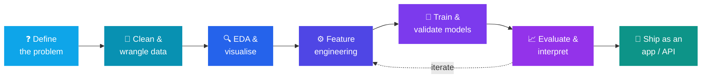
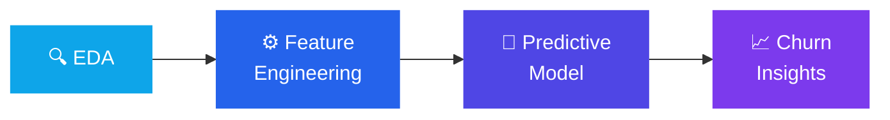
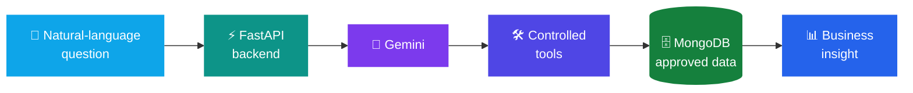
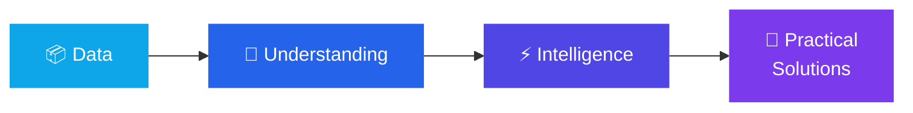

<!-- ═══════════════════════ HEADER ═══════════════════════ -->
<div align="center">


<a href="https://github.com/paraskosambe-web">

</a>

<br/>


<br/><br/>

<a href="https://paras-kosambe.vercel.app/"></a>
<a href="https://www.linkedin.com/in/paras-kosambe"></a>
<a href="mailto:paraskosambe@gmail.com"></a>
<a href="https://paras-kosambe.vercel.app/resume"></a>
<a href="https://www.instagram.com/paras.arts.3313/"></a>

</div>

<br/>

<!-- ═══════════════════════ NOTEBOOK INTRO ═══════════════════════ -->
<h2 align="center">📓 <code>README.ipynb</code> — Cell [1]: Who am I?</h2>

```python
In [1]: import profile as paras

In [2]: paras.describe()
```

```text
Out[2]:
┌──────────────────┬──────────────────────────────────────────────────────┐
│ name             │ Paras Sunil Kosambe                                  │
│ status           │ Final-year B.Sc. Computer Science, Univ. of Mumbai   │
│ college          │ D.G. Ruparel College                                 │
│ target_role      │ Data Scientist (AI/ML + software engineering)        │
│ core_stack       │ Python · SQL · Pandas · NumPy · Scikit-Learn         │
│ also_builds      │ Full-stack apps · AI agents · REST APIs              │
│ off_screen       │ Graphite · charcoal · digital sketch artist          │
│ location         │ Mumbai, India  (IST, UTC+5:30)                       │
│ philosophy       │ Learn → Build → Analyze → Improve                    │
│ open_to          │ Internships · Collabs · Real-world data problems     │
└──────────────────┴──────────────────────────────────────────────────────┘
```

I work across the **whole pipeline**: clean and explore data, engineer features, train and evaluate models, then ship the result as a real application people can actually use. I'd rather understand *why* a model behaves the way it does than collect buzzwords. The artist in me cares about how insights are *presented*, so I put as much thought into the interface as the model.


<!-- ═══════════════════════ PIPELINE ═══════════════════════ -->
<h2 align="center">🧬 How I Work: My Data Science Pipeline</h2>




<!-- ═══════════════════════ PROJECTS ═══════════════════════ -->
<h2 align="center">📓 Cell [2]: <code>projects.head()</code></h2>

| # | project | domain | stack | links |
|:-:|:--------|:-------|:------|:------|
| 0 | **📊 BCG X: PowerCo Churn Analysis** | Predictive modeling · EDA | Python · Pandas · NumPy · Scikit-Learn · Matplotlib · Seaborn | [repo](https://github.com/paraskosambe-web/bcg-x-data-science-job-simulation) |
| 1 | **🧪 InsightForge Data Workspace** | Interactive data exploration | React · TypeScript · Vite | [repo](https://github.com/paraskosambe-web/InsightForge-Data-Workspace) |
| 2 | **🤖 Paras Arts AI Data Agent** | Natural-language analytics (GenAI) | Python · FastAPI · MongoDB · Gemini | [repo](https://github.com/paraskosambe-web/paras-arts-ai-agent) |
| 3 | **🎨 Paras Arts Platform** | Full-stack product | React · Node.js · MongoDB · Cloudinary | [repo](https://github.com/paraskosambe-web/paras-arts-website) |

<div align="center"><sub>4 rows × 5 columns · full write-ups on my <a href="https://paras-kosambe.vercel.app/projects">portfolio</a></sub></div>

<br/>

<details open>
<summary><h3>📊 BCG X — Customer Churn Analysis for PowerCo</h3></summary>

Built during the **BCG X Data Science Virtual Experience**. The task was to work out *why* customers leave an energy provider and whether a model can predict it.



<p>

</p>

<a href="https://github.com/paraskosambe-web/bcg-x-data-science-job-simulation"></a>

</details>

<details open>
<summary><h3>🤖 Paras Arts AI Data Agent — talk to your business data</h3></summary>

An AI agent that lets a business owner ask questions in **plain English** and get answers from real data. The model never touches the database freely, it only calls **controlled tools** over approved data.



<p>

</p>

<a href="https://github.com/paraskosambe-web/paras-arts-ai-agent"></a>
<a href="https://paras-kosambe.vercel.app/projects/paras-arts-ai-data-agent"></a>

</details>

<details>
<summary><h3>🧪 InsightForge — interactive data workspace</h3></summary>

Upload a dataset, explore it, analyse it and understand it, all through a modern data-science-focused interface.

<p>

</p>

<a href="https://github.com/paraskosambe-web/InsightForge-Data-Workspace"></a>
<a href="https://paras-kosambe.vercel.app/projects/insightforge-data-workspace"></a>

</details>

<details>
<summary><h3>🎨 Paras Arts — custom sketch ordering platform</h3></summary>

A full-stack platform to showcase artwork, take custom sketch orders, track order status, and manage everything from an admin dashboard. This is where my art and my engineering meet.

<p>

</p>

<a href="https://github.com/paraskosambe-web/paras-arts-website"></a>
<a href="https://paras-kosambe.vercel.app/projects/paras-arts-digital-art-portfolio-custom-sketch-ordering-system"></a>

</details>


<!-- ═══════════════════════ MODEL CARD ═══════════════════════ -->
<h2 align="center">🪪 Cell [3]: Model Card: <code>Paras-v1.0</code></h2>

<table align="center">
<tr>
<td width="50%" valign="top">

**🎯 Intended use**
- Data science / analytics internships
- ML-powered product development
- Collaborations on real-world data problems

**💪 Strengths**
- End-to-end: data → model → deployed app
- Strong Python + SQL fundamentals
- Clean, user-friendly interface design
- Learns fast, ships fast

</td>
<td width="50%" valign="top">

**🔧 Known limitations (being fine-tuned)**
- Still growing in advanced statistics
- Limited production-scale ML experience
- Cloud / MLOps is an active learning area

**📏 Evaluation**
- Job simulations: BCG X · Tata (GenAI Analytics) · British Airways
- Projects shipped publicly on GitHub
- Portfolio live and deployed

</td>
</tr>
</table>


<!-- ═══════════════════════ SKILLS ═══════════════════════ -->
<h2 align="center">🛠️ Cell [4]: <code>skills.describe()</code></h2>

<div align="center">

**📊 Data Science & ML**


**💻 Languages & Databases**


**🌐 Full-Stack & APIs**


**🧰 Tools**


<br/>

<sub>Also working with: Seaborn · Hugging Face · Google Gemini · Cloudinary · Claude API</sub>

</div>

<br/>

<div align="center">

| 🧠 Skill area | Confidence | Level |
|:--|:--|:--|
| Python & Pandas |  | 85% |
| SQL |  | 75% |
| EDA & Visualisation |  | 80% |
| Machine Learning (sklearn) |  | 70% |
| Full-stack (React / Node / FastAPI) |  | 80% |
| NLP & GenAI / Agents |  | 65% |
| Statistics |  | 60% |
| Cloud & Deployment |  | 45% |

<sub>Self-assessed and kept honest. The low bars are what I'm working on next.</sub>

</div>


<!-- ═══════════════════════ TRAINING LOG ═══════════════════════ -->
<h2 align="center">🏋️ Cell [5]: Training Log <sub>(what I'm learning right now)</sub></h2>

```text
Epoch  Focus                          Status
─────  ─────────────────────────────  ──────────────────────────
 01    Statistics & probability       ██████████░░░░░░░░░░  in progress
 02    Predictive modeling & metrics  ████████████░░░░░░░░  in progress
 03    NLP & Generative AI            ████████░░░░░░░░░░░░  in progress
 04    AI agents & tool use           ██████████████░░░░░░  in progress
 05    Cloud & model deployment       ████░░░░░░░░░░░░░░░░  up next
```

<div align="center">


</div>


<!-- ═══════════════════════ GITHUB ANALYTICS ═══════════════════════ -->
<h2 align="center">📈 Cell [6]: <code>github.analytics()</code></h2>

<div align="center">


<br/>


<br/><br/>


<br/>

**🐍 Contribution Snake**

<picture>
  <source media="(prefers-color-scheme: dark)" srcset="https://raw.githubusercontent.com/paraskosambe-web/paraskosambe-web/output/github-snake-dark.svg"/>
  <source media="(prefers-color-scheme: light)" srcset="https://raw.githubusercontent.com/paraskosambe-web/paraskosambe-web/output/github-snake.svg"/>
  
</picture>

<br/>


</div>


<!-- ═══════════════════════ CERTIFICATIONS ═══════════════════════ -->
<h2 align="center">🏆 Cell [7]: Experience & Certifications</h2>

**Job simulations completed:** 🔹 BCG X (Data Science) &nbsp;·&nbsp; 🔹 Tata (GenAI-Powered Data Analytics) &nbsp;·&nbsp; 🔹 British Airways

**Learning areas covered:** AI & Machine Learning · Generative AI · Agentic AI · NLP · Data Analytics · Cloud AI Foundations · AI Ethics · Predictive Modeling

📜 Verified credentials live on my [portfolio certifications page](https://paras-kosambe.vercel.app/certifications).


<!-- ═══════════════════════ BEYOND CODE ═══════════════════════ -->
<h2 align="center">🎨 Cell [8]: <code>df.plot(kind='art')</code></h2>

<div align="center">

I'm also a **graphite, charcoal and digital artist**. Sketching trained me to notice small details, and that habit carries straight into spotting patterns in messy data and designing interfaces people enjoy using.

<a href="https://www.instagram.com/paras.arts.3313/"></a>
<a href="https://paras-kosambe.vercel.app/"></a>

</div>


<!-- ═══════════════════════ GOAL ═══════════════════════ -->
<h2 align="center">🌱 Cell [9]: <code>goal.fit()</code></h2>

<div align="center">

> A **Data Scientist** with strong **AI/ML and software engineering** skills, building things that turn raw data into decisions.



</div>

<!-- ═══════════════════════ CONTACT ═══════════════════════ -->
<h2 align="center">📫 Let's Connect</h2>

<div align="center">

| | |
|:--|:--|
| 📧 **Email** | [paraskosambe@gmail.com](mailto:paraskosambe@gmail.com) |
| 💼 **LinkedIn** | [in/paras-kosambe](https://www.linkedin.com/in/paras-kosambe) |
| 🌐 **Portfolio** | [paras-kosambe.vercel.app](https://paras-kosambe.vercel.app/) |
| 📄 **Resume** | [paras-kosambe.vercel.app/resume](https://paras-kosambe.vercel.app/resume) |
| 🎨 **Instagram** | [@paras.arts.3313](https://www.instagram.com/paras.arts.3313/) |

<br/>

<a href="mailto:paraskosambe@gmail.com"></a>
<a href="https://www.linkedin.com/in/paras-kosambe"></a>

<br/><br/>


</div>


